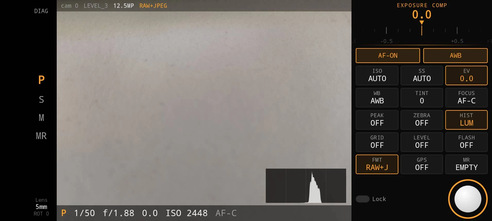

# ProCam

Manual camera app for the **Nothing Phone (2a) Plus** (`A142P`) and the **Sony
Xperia 1 VII** (`XQ-FS72`), built on Camera2
+ Jetpack Compose, with a DSLR-style landscape viewfinder.

Free software under the **GNU GPL v3 or later** — see [Licence](#licence).
Prebuilt debug APKs are attached to the [Releases](../../releases) page.



The viewfinder is landscape-only and laid out like a camera body rather than a
phone app. Amber always marks the one value the ruler is currently driving.

- **Left rail** — diagnostics, camera selector, the `P S M MR` mode dial, and
  the lens block (which doubles as the per-device preview-rotation control).
- **Centre** — live preview with the histogram, a status bar above it and a
  readout strip below it: mode, shutter, aperture, exposure compensation, ISO,
  focus. Neither bar covers the image; the preview is sized to fit between them.
- **Right deck** — the adjustment ruler on top, then `AF-C`/`AF-S` / `AWB`, then one
  button per control. Long-pressing `PEAK`, `ZEBRA` or `HIST` opens that
  overlay's fine adjustment on the ruler.


---

## Measured hardware facts

Everything below was read off the device, not from a spec sheet. The app still
queries `CameraCharacteristics` at runtime — these are only the values it was
tuned against.

| | camera `"0"` (back) | camera `"1"` (front) |
|---|---|---|
| Hardware level | `LEVEL_3` | `LEVEL_3` |
| ISO | 100 – 16000 (analog ≤ 1600) | 100 – 16000 |
| Exposure | **100 000 – 32 000 000 000 ns** (1/10000 s – 32 s) | same |
| Min focus distance | 20.0 diopters (~5 cm) | 0.0 — **fixed focus** |
| Exposure compensation | ±24 steps of 1/6 EV (±4 EV) | ±18 steps (±3 EV) |
| Aperture / focal | f/1.879 · 5.56 mm | f/2.2 · 3.61 mm |
| RAW | `RAW_SENSOR` 4080×3072 only | 4080×3072 |
| JPEG | 4080×3072 | 2448×2448 |
| Sensor orientation | 90 | 270 |
| CFA | GBRG | GBRG |

**Only two of the device's five cameras are openable by a normal app.** Devices
2, 3 and 4 — the ultra-wide among them — carry the `SYSTEM_CAMERA` capability
and are reserved for `com.nothing.camera`. There is no way to reach the
ultra-wide from a third-party app.

50 MP is likewise out of reach: `8160×6144` appears only under
`availableStreamConfigurationsMaximumResolution` and a `nothing.scaler.*` vendor
tag, while the camera does **not** advertise `ULTRA_HIGH_RESOLUTION_SENSOR`.

### Sony Xperia 1 VII (`XQ-FS72`)

Measured on Android 16, build `71.1.A.2.265`. Unlike the Nothing, **every
camera is open to third-party apps**, so the ultra-wide and the telephoto are
reachable from the `CAM` button. The lens block shows the 35 mm equivalent.

| camera | lens | level | ISO | longest exposure | RAW |
|---|---|---|---|---|---|
| `"0"` | logical back (main + 2/3/4) | `FULL` | 25 – 3200 | 1 s | 4000×3000 |
| `"1"` | front, 24 mm eq, fixed focus | `FULL` | 64 – 3200 | 1/4 s | 4000×3000 |
| `"2"` | main, 24 mm eq, f/1.9 | `FULL` | 25 – 3200 | 1 s | 4000×3000 |
| `"3"` | telephoto, 89 mm eq, f/2.4 | `LIMITED` | 32 – 2000 | 1/10 s | 4000×3000 |
| `"4"` | ultra-wide, 16 mm eq, f/2.0 | `FULL` | 50 – 3200 | 1/10 s | 4000×3000 |

All five accept `preview + YUV640 + JPEG + RAW`. CFA is `RGGB` on the main and
ultra-wide; sensor orientation is 90 on the back, 270 on the front. The preview
needs the same `+90` rotation correction as the Nothing, on every camera; it is
built in for this model.

**Long exposures stop at 1 s.** Sony publishes 30 s under the vendor tag
`com.sonymobile.sensor.info.exposureTimeRange`, which is what Photo Pro offers,
but the HAL validates `SENSOR_EXPOSURE_TIME` against the public range and fails
the whole device (`ERROR_CAMERA_DEVICE`) for anything longer:

```
camera-hal: validateCaptureSettings: Unsupported sensor exposure time value 4000000000 range (100000, 1000000000).
```

None of Sony's request or session vendor keys (`aeMode` 0–14, `usecase`,
`exposureTimeLimit`, `exposureTimeHint`, `highQualitySnapshotMode`,
`multiFrameNrMode`, `logicalMultiCamera.mode`) lifts that limit for a
third-party client, so the app keeps to the public range.

### Verified on device

```
accepted stream plan : preview + YUV640 + JPEG + RAW   (4 streams, first try)

REQUEST    REPORTED       DELTA          WALL      RESULT
4"         4"             0 ms           4559 ms   OK
8"         8"             0 ms           8561 ms   OK
16"        16"            0 ms           16581 ms  OK
32"        32"            0 ms           32558 ms  OK
VERDICT: full ladder honoured — no frame stacking needed

DNG  25 098 764 bytes  4080×3072
JPEG EXIF: ISO 500 · 1/60 s · 5.56 mm · f/1.879 · Nothing A142P
```

The diagnostics screen that produces this is in the app (`DIAG`, top-left).

---

## Build

Requires JDK 17+ (Android Studio's bundled JBR works) and Android SDK
platform 36 / build-tools 36. Point `local.properties` at your SDK, or set
`ANDROID_HOME`.

```bash
./gradlew assembleDebug
```

The wrapper pins Gradle **8.14.5** and fetches it on first run, so nothing has
to be installed beyond a JDK and the Android SDK.

Toolchain is pinned in `gradle/libs.versions.toml`: AGP 8.13.2, Kotlin 2.2.21,
Compose 1.9.5, `compileSdk`/`targetSdk` 36, `minSdk` 30. AndroidX is held at the
API-36 line deliberately — newer releases demand `compileSdk` 37 and AGP 9.1.

Install:

```bash
adb install -r ProCam-debug.apk
```

---

## Controls

Landscape only. Amber = the value the ruler is currently driving.

**Left rail** — `DIAG` opens the on-device diagnostics. `P S M MR` is the mode
dial. The lens block cycles a manual preview-rotation override (see below).

**Ruler (top of the deck)** — drag anywhere on the strip; it detents with
haptic ticks and eases onto the nearest value when you let go.

**Deck**

| Button | Tap | Long-press |
|---|---|---|
| `ISO` | switch to M and drive ISO | — |
| `SS` | switch to S and drive shutter | — |
| `EV` | drive exposure compensation (auto-exposure modes only) | — |
| `WB` / `TINT` | take manual white balance, drive Kelvin / tint | — |
| `AF-C` / `AF-S` | switch continuous ↔ single-shot AF; from manual focus, back to AF | — |
| `FOCUS` | manual focus (peaking stays as set; turn it on with `PEAK`) | — |
| `PEAK` | cycle `OFF → GRN → RED → WHT → OFF` | peaking-level ruler |
| `ZEBRA` | toggle | zebra-IRE ruler |
| `HIST` | toggle | switch luma ↔ RGB |
| `GRID` / `LEVEL` | toggle | — |
| `FLASH` | `OFF → ON → TORCH` | — |
| `FMT` | RAW+JPEG ↔ JPEG | — |
| `GPS` | GPS tagging (off by default) | — |
| `MR` | recall the stored setup | store the current setup |
| `VF` | viewfinder `60P ↔ 30P` (auto exposure only) | — |
| `RES` | photo size: `12M 4:3 → 11M 3:2 → 9M 16:9 → 9M 1:1` | — |
| `HDR` | `UHDR` (Ultra HDR JPEG) ↔ `SDR` (plain JPEG) | — |

**Hardware shutter key** — the only shutter; there is no on-screen button.
Half-press runs one AF cycle on the last tapped point, or the centre, and holds
focus while the key is held; the reticle turns green on lock. Full press shoots.
A quick full press waits up to 1.5 s for that AF cycle to lock first, so it is
not shot with a moving lens. In manual focus the half-press does nothing and
the full press just shoots. Both keys are kept by the app, so pressing them
never opens the system camera. The readout strip shows `SAVING…` while a shot
is being taken and written.

**AF-C and AF-S** — in AF-C the lens focuses continuously and a half-press
locks it. In AF-S the lens only moves for a half-press or a tap, and stays
where that left it after you let go, like single-shot AF on a camera body.

**Vibration** — a click when a half-press or tap AF cycle locks focus, two
light ticks when it gives up, and the same short click when a shot has been
saved, so the camera can be worked without looking at the screen. They play as touch
feedback, so the system touch-vibration strength setting scales them.

**RES and HDR** — `RES` picks the largest JPEG the camera makes in each
aspect ratio; for anything but 4:3 the preview darkens what the crop will cut.
RAW stays the full 4000×3000 sensor frame whatever `RES` says.

`HDR` saves Ultra HDR: the ordinary SDR JPEG, untouched, plus a gain map that
tells an HDR screen how much brighter each region may be shown. The gain map
is built by ProCam from RAW, because the camera HAL will not do it for a
third-party app — its own `JPEG_R` output has a gain map of flat zero unless
the client is Sony's camera app (whose shots go through a 12-frame `HdrComp`
merge that no request or session setting would enable here). It does this on
every camera, physical lenses included. In `HDR` mode a shot is a two-frame
burst: the normal frame (JPEG + RAW) and a RAW frame two stops darker. Where
the normal RAW runs into white — a window, a lamp, the sky — the dark frame
still holds the highlight, blended in gradually as the normal frame nears
clipping, and RAW luminance over JPEG luminance, matched in the midtones, is
the boost. The dark frame is sent as a preview-type request: as a still, the
HAL hands back a buffered frame at the normal exposure while its metadata
claims the dark settings. The exposure ratio between the two frames is
therefore measured from the pixels, and a dark frame that is not actually
darker is ignored. Shadows and midtones are left exactly
as the SDR picture has them; the boost fades in above middle grey and is
capped at three stops. The summary line shows how much range the shot got
(`UHDR … +2.3EV`), or `(no HDR highlights)` when the scene had none. `HDR`
needs the RAW stream, and works with `FMT JPEG` too (the RAW is then used and
not saved).

The 48 MP main sensor is not offered. Its maximum-resolution mode does
capture, but the Xperia 1 VII's camera HAL crashes about a second after every
such still — JPEG or RAW, preview running or paused — and takes the open
camera with it. If the camera is lost for any reason while the app is in
front, it reopens on its own two seconds later.

**Preview** — tap to place the AF point; the reticle turns green on lock, red on
failure. Tap the histogram to switch luma/RGB.

### Modes

- **P** — auto exposure, EV compensation only.
- **S** — you set the shutter; ISO is servo'd from the analysis stream's mean
  luma. Camera2 has no shutter-priority mode (AE either owns both time and gain
  or neither), so the loop is closed in the app.
- **M** — full manual.
- **MR** — recall a stored setup.

Switching out of P carries the metered ISO and shutter over, so the image does
not jump.

### Viewfinder latency

`VF 60P` (the default) runs auto exposure at the camera's fixed 60 fps range.
Measured on the Xperia 1 VII, from the frame's sensor timestamp to the glass:

| stage | 30 fps | 60 fps |
|---|---|---|
| camera HAL, sensor → frame handed to the app | ~75 ms | ~75 ms |
| ProCam, frame → drawn (GL shader incl. peaking) | 0.5 ms | 0.5 ms |
| SurfaceFlinger, posted → on screen (60 Hz panel) | ~23 ms | ~25 ms |
| exposure + time each frame stays up | ~33 ms | ~17 ms |

The HAL's ~75 ms does not move for frame rate, preview size, the stream set
(RAW and JPEG or not), logical or physical camera, the PREVIEW stream use case,
noise-reduction mode or any of Sony's vendor modes, so 60 fps is what an app
can win: about 15 ms fresher on average, and smooth motion. The price is that
auto exposure stops at 1/60 s and raises ISO instead; `30P` gives P mode the
1/30 s back for dim scenes. S and M set their own frame time.

The app also asks for the panel's fastest mode (120 Hz), which would take
another ~12 ms off, but the system refresh-rate cap outranks app requests and
at the phone's default setting the display stays at 60 Hz.

### Long exposures

With AE off the preview frame rate is `1 / exposureTime`, so a 32 s setting
would freeze the viewfinder for 32 s a frame. The repeating request is therefore
capped at 1/8 s and compensates with ISO; the still request uses the real value.
The viewfinder says `PREVIEW SIMULATED` while that is happening.

---

## Privacy

- **No `INTERNET` permission.** Nothing this app captures can leave the device.
- GPS tagging is **off by default** and location is only requested when you
  switch it on — once a GPS tag is in a file it travels with every copy.
- `allowBackup="false"`, so the MR slot is not synced anywhere.
- The `run_diagnostics` intent extra is honoured only in debuggable builds; the
  launcher activity is exported and would otherwise let any installed app make
  the camera open and write files.

---

## Known gaps

- **Flipped landscape (`ROTATION_270`) is unverified.** The textbook
  `SENSOR_ORIENTATION - displayRotation` term lands a quarter turn short on this
  device; `PREVIEW_ROTATION_CORRECTION = 90` in `CameraScreen.kt` was measured
  by comparing the viewfinder against a JPEG shot in the same session at
  `ROTATION_90`. If the preview is upside down when the phone is held the other
  way, tap the lens block to correct it and the formula needs the display term
  sign flipped.
- Front camera is untested on the Nothing; it is fixed-focus and tops out at a
  square JPEG. On the Xperia it works, mirrored, at the same `+90` correction.
- No video.
- Release build has no signing config and no shrinking.

---

## Influences

The viewfinder layout owes a clear debt to Sony's Photo Pro on Xperia phones: a
landscape deck of one-touch controls, a scrubber for whichever parameter is
selected, and a readout strip along the bottom. That arrangement is a good
answer to the problem of putting camera controls on a touchscreen, and this
project borrows the idea openly.

What it does not borrow is anything of Sony's to borrow. Every line of code here
is written against the Android Camera2 API; no Sony code was decompiled or
consulted, and no Sony icons, fonts or assets are used — the interface is drawn
with Compose Canvas primitives.

The `P` / `S` / `M` mode naming is an industry convention that long predates any
of this, and `MR` is the same idea as Canon's `C1`/`C2`/`C3` or Nikon's
`U1`/`U2`.

ProCam is not affiliated with, endorsed by, or connected to Sony Group
Corporation in any way. Sony, Xperia, Photo Pro and Cinema Pro are trademarks of
their respective owners and are used here only to describe what inspired this
project.

---

## Licence

ProCam is free software, licensed under the
**GNU General Public License, version 3 or (at your option) any later version**.

The full text is in [`LICENSE`](LICENSE).

In plain terms, and without being legal advice:

- You may **use, study, modify and share** this app and its source freely.
- If you **distribute** a copy, modified or not — as an APK, a fork, or inside
  another product — you must also release the **complete corresponding source**
  of what you distributed, under the **same GPL-3.0 licence**, and say what you
  changed.
- Changes you keep **to yourself** carry no obligation. The copyleft duty is
  triggered by distribution, not by private use.
- There is **no warranty**.

This is deliberate: the aim is that improvements to ProCam stay available to
everyone who receives it.

### Third-party components

| Component | Licence | Compatible with GPL-3.0 |
|---|---|---|
| AndroidX / Jetpack Compose | Apache-2.0 | yes (Apache-2.0 → GPL-3.0 is one-way compatible) |
| `androidx.exifinterface` | Apache-2.0 | yes |
| `android.hardware.camera2`, `DngCreator`, OpenGL ES | part of the Android platform | n/a — platform API |

Everything else — the Camera2 pipeline, the Sobel focus-peaking and zebra
shaders, the histogram engine, the electronic level and the whole UI — is
original work in this repository.

## Contributing

Issues and pull requests are welcome. By contributing you agree that your
contribution is licensed under GPL-3.0-or-later as well.

If you are reporting a camera problem, the **DIAG** screen in the app prints the
full `CameraCharacteristics` dump, the accepted stream combination and an
exposure-ladder test — please paste that output into the issue.
